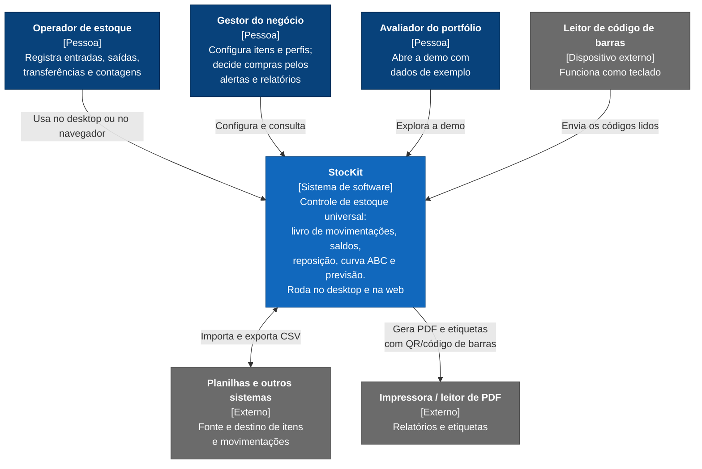

# C4 nível 1 — Contexto do sistema

O StocKit visto de fora: quem o usa e com o que ele troca informação. Não há integração direta com outros sistemas
(ERP, fiscal e PDV estão fora do escopo, §3); a troca acontece por arquivos CSV.

## Elementos

| Elemento | Tipo | Papel | Requisitos |
|---|---|---|---|
| Operador de estoque | Pessoa | Opera o dia a dia: movimentações, contagens, consulta de saldo e extrato | RF-005, RF-012, RF-017, RF-024 |
| Gestor do negócio | Pessoa | Cadastra itens, locais, partes e perfis; acompanha dashboard, alertas e sugestão de compra | RF-001..RF-004, RF-011, RF-016, RF-018..RF-023 |
| Avaliador do portfólio | Pessoa | Abre o `.exe` ou a demo web com dados determinísticos | RF-028 |
| Leitor de código de barras | Dispositivo | Lê o código e "digita" no campo focado (modo scanner) | RF-017 |
| Planilhas e outros sistemas | Externo | Origem e destino de dados em CSV, com relatório de erros por linha | RF-015 |
| Impressora / leitor de PDF | Externo | Recebe relatórios e etiquetas | RF-025 |

## Fora deste diagrama (de propósito)

- **Sincronização desktop ↔ web:** não existe no escopo atual (P-05, backlog B-01). Cada plataforma tem seus dados.
- **Servidor dedicado:** não há; ver os modos de execução em `PROJECT_CONTEXT.md` §5.3 e o nível 2.
