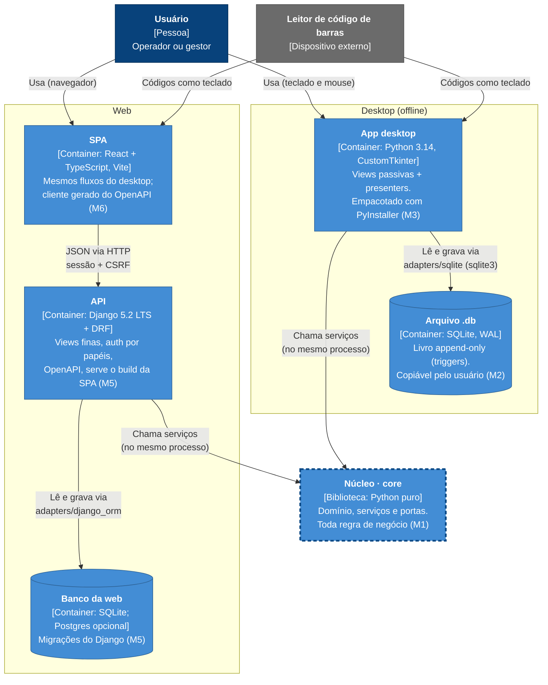

# C4 nível 2 — Containers

O StocKit por dentro: duas plataformas independentes que compartilham o mesmo **núcleo** (ADR-001). O núcleo não é um
processo à parte: é uma biblioteca Python que roda **dentro** do app desktop e **dentro** da API.

## Elementos

| Container | Tecnologia | Responsabilidade | Não faz | Milestone |
|---|---|---|---|---|
| App desktop | Python 3.14, CustomTkinter | Telas, navegação, modo scanner; **composition root** que liga serviços ao adaptador SQLite | Regra de negócio (fica no núcleo) | M3 |
| Arquivo `.db` | SQLite (`sqlite3`), WAL, `foreign_keys=ON` | Persistir itens, locais, partes, lotes e o livro de movimentações; migrações por `PRAGMA user_version` | Guardar saldo como verdade (ADR-004) | M2 |
| Núcleo (`core`) | Python puro, sem dependências | Domínio, invariantes, casos de uso e portas (`Protocol`) | Importar banco, UI, framework ou rede (import-linter) | M1 |
| SPA | React + TypeScript, Vite, TanStack Query | Interface web com os mesmos fluxos do desktop | Regra de negócio; acesso direto ao banco | M6 |
| API | Django 5.2 LTS + DRF, drf-spectacular, WhiteNoise | Autenticação e papéis, endpoints finos sobre o núcleo, erros padronizados, OpenAPI; serve o build da SPA | Regra em models, signals ou serializers (ADR-003) | M5 |
| Banco da web | SQLite (local/demo); Postgres se houver uso real | Mesmo modelo de dados, via Django ORM | — | M5 |

## Adaptadores (dentro dos containers)

| Adaptador | Implementa as portas para | Roda em | Garantia de equivalência |
|---|---|---|---|
| `adapters/memory` | Testes do núcleo | pytest | Referência da suíte de contrato (M1.5) |
| `adapters/sqlite` | Desktop (ADR-002) | App desktop | Suíte de contrato (M2.6) |
| `adapters/django_orm` | Web (ADR-003) | API | Suíte de contrato (M5.3) e paridade com JSON dourado (M5.10) |

## Variações de execução

- **Vitrine estática (M7.4):** o build da SPA publicado no GitHub Pages fala com uma **API simulada** (MSW) no próprio
  navegador, sem API nem banco reais.
- **Demo online (M7.3):** API + SPA num plano gratuito, banco recriado com o dataset de referência a cada boot.
- **Sem sincronização:** não há ligação entre `Arquivo .db` e `Banco da web` (P-05, B-01). A igualdade de
  comportamento é provada por testes (RNF-004), não por troca de dados.
